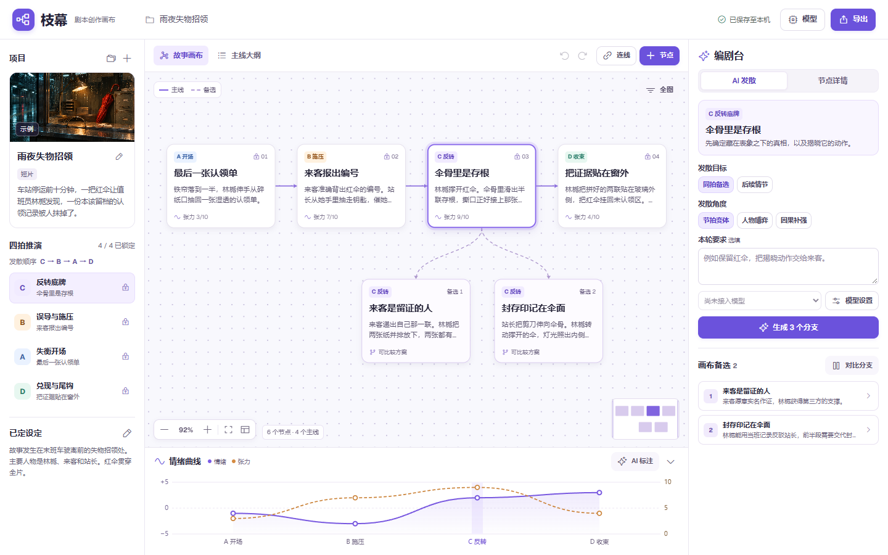

# 枝幕 Zhimu Story Canvas

枝幕是为影视剧本开发设计的多模型故事画布。把梗概、情节动作、前因后果和伏笔放在同一张画布上。在任意节拍探索备选，比较它们会改动哪些前后剧情，再把选中的方案锁进主线。



## 启动

需要 Node.js 22 或更新版本。在仓库目录执行下面两条命令。

```sh
npm ci
npm start
```

打开 [本机工作台](http://127.0.0.1:3742)。首次启动会载入虚构示例《雨夜失物招领》。左栏的 `+` 可新建自己的项目。

## 在画布上推演

1. 写一句话梗概，记录已确定的人物、关系和规则。四拍推演可按 **C 反转底牌 → B 误导与施压 → A 失衡开场 → D 兑现与尾钩** 开发。主线大纲的顺序是成片的叙事顺序，可以手动调整。
2. 点击任意节点进入详情。在 **AI 发散** 中选择同拍备选或后续情节。AI 每轮给三个候选，点击 **放上画布** 后才添加卡片。
3. 用 **对比分支** 查看各方案的动作、前因、后果、伏笔和联动修改。锁定新方案会把旧方案留作备选。自由情节也可纳入主线。
4. 拖动空白平移，拖动卡片调整布局，使用 Ctrl / Cmd 加滚轮或左下角控件缩放。用 **连线** 依次点选起点和终点，可标记额外因果关系。
5. 下方曲线按当前主线排列。紫线表示观众情绪正负（−5 到 +5），橙线表示冲突或悬念张力（0 到 10）。点选曲线可定位到相应剧情。分值可以手动录入，也可以用当前模型批量标注，再由创作者调整。

## 接入模型

打开右上角 **模型**，添加任意数量的模型配置。在编剧台切换当前模型。模型 ID 以你在对应服务看到的值为准。

| 接口类型 | 默认 API Base URL | 密钥 |
| --- | --- | --- |
| [OpenAI 兼容](https://developers.openai.com/api/reference/resources/chat/subresources/completions/methods/create) | `https://api.openai.com/v1` | 云服务使用该服务的 API Key |
| [Anthropic](https://platform.claude.com/docs/en/api/messages/create) | `https://api.anthropic.com/v1` | Anthropic API Key |
| [Gemini](https://ai.google.dev/api/generate-content) | `https://generativelanguage.googleapis.com/v1beta` | Gemini API Key |
| [Ollama](https://docs.ollama.com/api/openai-compatibility) | `http://127.0.0.1:11434/v1` | 本机服务可留空 |

Base URL 填接口前缀，例如 `https://api.openai.com/v1`。枝幕根据配置追加请求路径。选模型后用 **测试连接** 检查凭据、地址和模型 ID。

页面填写的 Key 只留在当前页面内存。需要固定一个本机默认配置时，可复制 `.env.example` 为 `.env`，填写 `STORY_AI_PROVIDER`、`STORY_AI_MODEL` 及所需地址和密钥，重启服务。模型设置中的 **本机环境配置** 会读取它。模型请求从本机服务发送，所选模型服务会收到完成本轮操作所需的剧情上下文。

## 导出与备份

- **Word、PDF、Markdown、纯文本**导出当前主线、梗概、已定设定、节点因果、伏笔、情绪标注及已写入的场景正文。
- **项目 JSON**保留所有节点、备选、画布坐标、因果连线和主线顺序。用左栏 **项目列表 → 导入项目** 恢复为一个独立项目。

项目保存在浏览器的本机存储中。更换浏览器或本机访问地址时，可用项目 JSON 迁移。每个项目最多 500 个节点。服务监听本机回环地址，适合个人使用。

## 源码

- `public/` 包含工作台、画布、情绪曲线和项目数据结构。
- `lib/ai.mjs` 包含模型接口适配及剧本开发提示词。
- `lib/documents.mjs` 负责各格式导出，`server.mjs` 提供本机服务。

代码采用 [MIT 许可](LICENSE)。PDF 内嵌 [Noto Sans SC](https://github.com/notofonts/noto-cjk) 字体，字体许可见 [OFL](lib/fonts/OFL.txt)。示例故事和封面为本项目制作。

<details>
<summary>示例封面来源</summary>

`public/assets/rain.png` 由内置 ImageGen 生成。使用的提示词如下。

> Create a landscape cinematic film still for a small thumbnail cover of an original Chinese suspense short about a red umbrella in a train station lost-and-found office. Medium-wide shot through a rain-speckled glass ticket window late at night. A single folded vivid vermilion umbrella, with its curved handle visible, leans at the center-right of a worn counter beside a few small blank paper claim slips. Warm tungsten task lamp inside, desaturated midnight blue and teal reflections outside, strong contrast, realistic water and metal textures, restrained 35mm film grain. Compose so the umbrella and lamp are immediately legible in a tight 2:1 horizontal crop at very small size. Contemporary modest municipal station, completely empty, no people. No legible text, no typography, no logos, no watermark.

</details>
