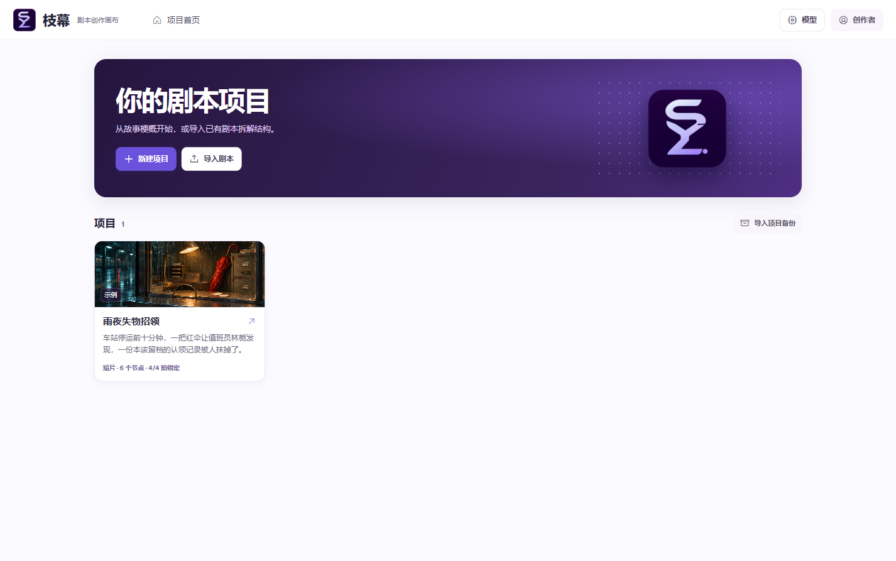

# 枝幕 Zhimu Story Canvas

枝幕是一款为影视剧本开发设计的 Windows 桌面软件。在同一张无限画布上搭建人物设定、因果和剧情分支，为不同节点选用模型，并把采纳的剧情整理成主线。


## 运行桌面版

双击 Windows x64 便携版 `Zhimu-0.5.0-Windows-x64.exe` 即可打开独立窗口。首次启动创建本机账号，登录后可以新建画布、导入剧本，或打开虚构示例《雨夜失物招领》。升级后可以用原有本机账号继续编辑项目。



从源码启动需要 Node.js 22.13 或更新版本。在仓库目录执行下面两条命令。

```sh
npm ci
npm start
```

运行 `npm run package:win` 可在 `dist/` 生成 Windows x64 便携版。开发时也可用 `npm run preview` 在本机浏览器预览界面。

## 在画布上推演

1. 在选择模式下按住左键拖动空白处框选，按 `Shift` 可追加选择。抓手、空格加拖动或鼠标中键可平移，滚轮可缩放。拖动已选节点会移动整个选区。
2. 从卡片右侧拖线到另一张卡片的输入端口。拖到空白处会打开菜单，选定类型后创建并连入新节点。选中卡片可以查看和移除引用，也可从 **添加参考** 选择已有节点。
3. 在剧情卡片下方选择模型、填写生成要求，再点 **生成** 或按 `Ctrl+Enter`。每轮方案随项目保存，可以应用到当前节点或接出一个分支。当前节点、生成要求及沿入站连线可达的内容会交给本轮模型。跨模型继续推演时，沿线保留已采纳的细节。
4. 右键点击剧情卡片，选择 **纳入主线**。空白处右键打开 **主线大纲** 可调整叙事顺序和情绪标注，同一菜单也可导出文档。`Ctrl+Z` 撤销，`Ctrl+Shift+Z` 重做，`Esc` 关闭菜单或取消连线。
5. 下方曲线按主线顺序绘制。紫线表示观众情绪（−5 到 +5），橙线表示冲突或悬念张力（0 到 10）。点选曲线可定位剧情。分值可以手动编辑，也可使用 **AI 标注** 后调整。
6. 底栏提供选择、抓手、画笔、点子、分组、文本、搜索和添加节点。左下角可缩放、适配画布、开关小地图。右键、双击空白处或按 `Insert` 也可添加节点。选中节点按 `Delete` 立即删除，按 `Ctrl+Z` 撤回。

## 从点子开始

1. 点底栏灯泡，在画布上放一张点子。可手写灵感、接入设定与剧情，也可留空交给模型。
2. 选中点子，选择模型和每轮数量（1–8 条）。「模型自由想」「剧情走向」「人物关系」「冲突与两难」「悬念反转」「场景构想」各有独立选项卡，可填写补充要求。
3. 点击「发散点子」。每条结果会单独生成一张点子卡，并连到原点子。可用 `Ctrl+Z` 整批撤回。
4. 选一张点子连到剧情节点，或用「展开为剧情节点」直接接着写。下游模型读取选中路线和它沿线接入的参考。旧项目中的便签会转换成点子卡。

## 从一个选择写到一场戏

1. 在点子或剧情节点点 **接着写**。模型根据当前节点和连入的素材提出一个问题，并列出不同的人物行动、回应和场尾变化。点一个选项，或写自己的决定，修改草稿后点 **接出剧情节点**。新节点会连到来源，可继续往下写。
2. 在选定的点子或剧情上右键 **整理为故事梗概**，也可在 **主线大纲** 里整理整条主线。编辑并保存梗概后，选中梗概卡点 **拆成分场**，一次可生成 2–12 场。分场依叙事顺序串联，创建时可选择是否加入主线。
3. 在主线大纲里拖动序号或用「上移／下移」排序。选中分场卡点 **写成场景正文**，可审阅和修改草稿再应用。梗概、分场和来源都可沿连线查阅。
4. 点击情绪曲线的点，查看场景、观众已知、触发变化的动作和标注依据。上游内容、引用或主线顺序有变化时，会提示复核可能受影响的后续场景。剧情可以单独确认复核，手动更新或重新 AI 标注可更新情绪复核状态。

## 创作方法

新建画布后可以选一种方法。左上角 Logo 旁始终显示当前方法，点击可切换。未解锁的账号可以试看每种方法的第一阶段。解锁后，方法面板逐阶段给出起步问题、要写什么和写完检查。选中剧情或 Agent 节点可指定阶段，并把起步问题加入输入框。方法和阶段随项目保存，可指导 AI 推演。剧本导入按原作顺序拆解。

- **三幕结构**适合第一次整理完整故事，用建置、对抗和解决串起主角的行动。 [Syd Field 官方工作表](https://sydfield.com/syd_resources/the-paradigm-worksheet/)
- **故事环**从人物欲望出发，沿着尝试、获得、代价与回归去设计人物改变。 [Dan Harmon 在 Channel 101 的教程](https://channel101.fandom.com/wiki/Story_Structure_101:_Super_Basic_Shit)
- **Save the Cat! 15 节拍**可用于检查事件推进、关键转折与首尾对照。 [Save the Cat! 官方节拍说明](https://savethecat.com/news/its-here-save-the-cat-story-structure-software-30-on-sale-today)
- **剧情序列法**适合把长片或剧集拆成若干个有戏剧目标的场景组。枝幕提供八段起步问题。 [Paul Joseph Gulino 著作介绍](https://www.bloomsbury.com/us/screenwriting-9798765104613/)
- **雪花法**把 Randy Ingermanson 的小说扩写思路改编为剧本开发流程，从一句话扩到梗概、人物、分场与初稿。 [作者原文](https://www.advancedfictionwriting.com/articles/snowflake-method/)
- **逆向反转四拍**来自本项目的《剧本创作 Skill 4.0》，按底牌、误导与施压、开场、兑现的顺序推演。
- **自由创作**可从任意人物、场景或决定开始。

### 地区解锁

未解锁时，左下角礼包进入收银台。中国大陆 ¥1，美元结算地区 US$1，均为一次购买。支付确认后显示完整方法与恢复码。自由创作可直接使用。

- 中国大陆使用微信支付 Native 扫码。¥1 对应订单金额 100 分，需要商户开通对应产品并配置回调。 [微信支付产品介绍](https://pay.wechatpay.cn/doc/v3/merchant/4012791874) · [Native 下单](https://pay.wechatpay.cn/doc/v3/merchant/4012791877)
- 美元使用 Stripe Checkout。按美元结算的最低金额为 US$0.50。以美国国内卡标准费率估算，US$1 每笔手续费约 US$0.33。实际费用以商户的结算地区和支付方式为准。 [Stripe 币种及最低金额](https://docs.stripe.com/currencies) · [Stripe 美国定价](https://stripe.com/pricing?locale=en-US)
- 服务端创建订单、验证通知签名，并主动查单核对订单、商户、币种和金额。重复通知使用同一笔权益记录。完整引导由付费服务发放。 [微信支付回调通知](https://pay.wechatpay.cn/doc/v3/merchant/4012791882) · [Stripe 履约指南](https://docs.stripe.com/checkout/fulfillment)

#### 启用收银台

部署 `commerce/server.mjs`，并用 HTTPS 反向代理到本机监听端口。收银台进程使用持久化 SQLite 文件，服务重启时沿用该文件。以下变量由商户在服务端配置，至少开通一条支付渠道。

| 用途 | 服务端变量 |
| --- | --- |
| 基本配置 | `ZHIMU_CHECKOUT_ORIGIN` 为专用 HTTPS 源，`ZHIMU_GUIDE_FILE` 为私有引导 JSON 路径，`ZHIMU_CHECKOUT_DATABASE` 为 SQLite 文件路径，`ZHIMU_CHECKOUT_PORT` 默认 `8795` |
| Stripe | `STRIPE_SECRET_KEY`、`STRIPE_WEBHOOK_SECRET`。Webhook `/hooks/stripe` 接收 `checkout.session.completed` 与 `checkout.session.async_payment_succeeded` |
| 微信支付 | `WECHAT_APP_ID`、`WECHAT_MERCHANT_ID`、`WECHAT_MERCHANT_SERIAL`、`WECHAT_PRIVATE_KEY_FILE`、`WECHAT_PLATFORM_SERIAL`、`WECHAT_PLATFORM_KEY_FILE`、`WECHAT_API_V3_KEY`。下单使用 `/hooks/wechat` 回调 |

环境变量设置后运行 `npm run checkout`。Windows 客户端在 `%APPDATA%\ZhimuStoryCanvas\model.env` 中配置 `ZHIMU_COMMERCE_ORIGIN`，指向收银台的 HTTPS 源。商户密钥与完整引导 JSON 留在服务端。用 Stripe 测试模式和微信商户测试核对首笔真实流程、回调和恢复购买后再对外启用。

作者可在本机用 `--guide-preview="引导 JSON 的绝对路径"` 查看完整指引。作者预览在未配置收银台时生效，礼包保留预览入口。

## 接入模型

打开右上角账号菜单里的 **用户设置**。已连接的账号和 API 模型可在剧情节点选择。Agent 节点使用同一设置页中的专用 **Agent 接口**。

- **ChatGPT** 在本机免费使用场景采用官方 Sign in with ChatGPT。在浏览器授权后列出该账号可用的模型。带收费或远程服务的发行场景需走 OpenAI 合作接入。 [OpenAI 官方本地接入说明](https://developers.openai.com/siwc/token-sharing-open-source)
- **Gemini** 通过 Google OAuth 授权调用已启用 Gemini API 的 Google Cloud 项目。可在设置中导入 OAuth 桌面客户端 JSON，发行方也可在 `model.env` 提供 `ZHIMU_GOOGLE_CLIENT_ID`、`ZHIMU_GOOGLE_CLIENT_SECRET`、`ZHIMU_GOOGLE_PROJECT`。Google AI 消费订阅与此处的 Cloud API 配额分别管理。 [Google Gemini API OAuth](https://ai.google.dev/gemini-api/docs/oauth) · [Google 桌面应用 OAuth](https://developers.google.com/identity/protocols/oauth2/native-app)
- **API 模型**填写 Base URL、模型 ID 和 API Key。模型 ID 以服务商提供的值为准。

| 接口类型 | 默认 API Base URL | 密钥 |
| --- | --- | --- |
| [OpenAI 兼容](https://developers.openai.com/api/reference/resources/chat/subresources/completions/methods/create) | `https://api.openai.com/v1` | 云服务使用该服务的 API Key |
| [Anthropic](https://platform.claude.com/docs/en/api/messages/create) | `https://api.anthropic.com/v1` | Anthropic API Key |
| [Gemini](https://ai.google.dev/api/generate-content) | `https://generativelanguage.googleapis.com/v1beta` | Gemini API Key |
| [Ollama](https://docs.ollama.com/api/openai-compatibility) | `http://127.0.0.1:11434/v1` | 本机服务可留空 |

Base URL 填接口前缀，例如 `https://api.openai.com/v1`。枝幕根据配置追加请求路径。选模型后用 **测试连接** 检查凭据、地址和模型 ID。

Windows 桌面版使用 Electron `safeStorage` 按本机账号加密保存 API Key、账号授权和购买凭据。项目备份只保留模型配置编号。开发预览中的 API 配置会在预览服务重启后清空。 [Electron safeStorage 文档](https://www.electronjs.org/docs/latest/api/safe-storage)

## 导入剧本并拆解

在首页选 **导入剧本**，选择或拖入 DOCX、带文字层的 PDF、Markdown、TXT 或 Fountain。文件读完后选模型和作品体量，点 **拆解结构**。较长的文本会逐段提取线索，再合并成结构。审阅情节节点、结构诊断和可在原文中核对的引句，勾选要保留的节点并 **应用为新项目**。单个文档上限 16 MB，正文上限 18 万字符。

## 导出与备份

- **Word、PDF、Markdown、纯文本**导出当前主线、沿线文本与设定、节点因果、伏笔、情绪标注及已写入的场景正文。旧项目中的梗概和共享设定会转换成独立卡片。
- **项目 JSON**保留所有节点、待选候选、模型配置引用、分组、画笔标注、画布坐标、因果连线和主线顺序。在首页选 **导入项目备份** 恢复为独立项目。换电脑后可以重新为节点选择可用模型。

桌面版按本机账号保存项目，每个项目最多 500 个节点。

## 源码

- `public/` 包含主页、画布、情绪曲线和项目数据结构。
- `lib/ai.mjs` 包含模型接口适配及剧本开发提示词。
- `lib/documents.mjs` 负责各格式导出，`lib/service.mjs` 提供应用内接口。
- `lib/import.mjs` 读取剧本文字，`lib/accounts.mjs` 管理本机账号，`lib/model-settings.mjs` 管理模型配置。
- `desktop.mjs` 启动桌面窗口，`server.mjs` 提供开发预览。
- `commerce/` 提供收银台与解锁服务。

画布布局参考 LibTV，拖线到空白处建节点和循环检测参考 React Flow 的公开示例。底部工具条参考 OpenBot 的画布界面。开场和生成状态反馈参考 OpenBot 公布的品牌过渡与工作动效。 [LibTV 官网](https://www.liblib.tv/) · [React Flow 新建连线节点](https://reactflow.dev/examples/nodes/add-node-on-edge-drop) · [React Flow 循环检测](https://reactflow.dev/examples/interaction/prevent-cycles) · [OpenBot 更新记录](https://openbot.run/changelog)

代码采用 MIT 许可。PDF 内嵌 Noto Sans SC 字体。示例故事、封面、SYZ 图标和开场的分叉故事板画面为本项目制作。 [MIT 许可](LICENSE) · [字体项目](https://github.com/notofonts/noto-cjk) · [字体许可](lib/fonts/OFL.txt)

<details>
<summary>SYZ 图标</summary>

`public/assets/syz.png` 由内置 ImageGen 生成并精修。S 曲线对应故事推进，Y 分叉对应多条备选，Z 的折线与末端节点对应选定路线继续向下一拍推进。

> Generate a genuinely designed abstract SYZ monogram symbol as a polished square Windows app icon, completely fresh concept. A single continuous custom geometric ribbon glyph merges an S-shaped curved upper path, a Y junction with one short split arm, and an angular Z-like lower turn in the same central sign. Shared strokes and thoughtfully cut negative space form the letter references. One bold clean silhouette, recognizable even at 24 pixels. The emblem is pale periwinkle and nearly white at its top, softly violet at its base, on a very dark ink-plum rounded-square tile. Use restrained modern graphic design, crisp vector-like edges, optical balance, generous negative space, and at most one tiny lilac terminal to suggest a story node. The icon tile fills about 94 percent of the square image, with transparent alpha outside the tile. Show a single straight-on finished icon centered, no separate typography, no caption, no accompanying wordmark, no shadows outside the tile, no 3D or mockup, no watermark.

> Produce a clean finished app-icon version of the supplied SYZ ribbon monogram. Preserve the distinct continuous S curve, Y-shaped branch, angular Z foot, and the single small lilac terminal at lower right. Preserve their overall shape, location, proportions, and pale-lavender-to-violet fill. Set them on one perfectly clean, fully opaque, smooth midnight ink-plum rounded-square tile, with very subtle uniform tonal gradient and no surface texture. The background immediately to the right of the Y branch is continuous clean dark plum. The only transparent pixels are the exterior beyond the rounded-square tile. Large crisp centered flat icon suitable for the Windows taskbar. The ribbon, one dot, and one tile are the complete artwork.

</details>

<details>
<summary>示例封面来源</summary>

`public/assets/rain.png` 由内置 ImageGen 生成。使用的提示词如下。

> Create a landscape cinematic film still for a small thumbnail cover of an original Chinese suspense short about a red umbrella in a train station lost-and-found office. Medium-wide shot through a rain-speckled glass ticket window late at night. A single folded vivid vermilion umbrella, with its curved handle visible, leans at the center-right of a worn counter beside a few small blank paper claim slips. Warm tungsten task lamp inside, desaturated midnight blue and teal reflections outside, strong contrast, realistic water and metal textures, restrained 35mm film grain. Compose so the umbrella and lamp are immediately legible in a tight 2:1 horizontal crop at very small size. Contemporary modest municipal station, completely empty, no people. No legible text, no typography, no logos, no watermark.

</details>
